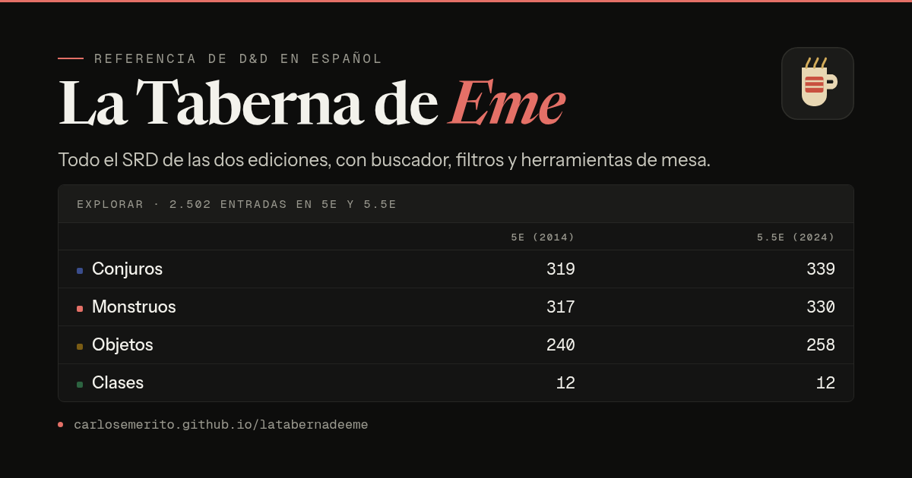

# La Taberna de Eme

[](https://github.com/CarlosEmerito/latabernadeeme/actions/workflows/deploy.yml)
[](LICENSE)
[](LICENSE-CONTENT)
[](https://carlosemerito.github.io/latabernadeeme/)

Referencia y herramientas de mesa para **D&D quinta edición** (reglas de 2014) y **quinta edición revisada** (reglas de 2024), construida sobre el contenido abierto del *System Reference Document* en su traducción oficial al español. Sin cuenta, sin servidor y sin base de datos: HTML estático, búsqueda en el navegador y todo el texto a un clic.

**[Abrir la web →](https://carlosemerito.github.io/latabernadeeme/)**



## Qué hay dentro

Dos apartados, `5e` y `5.5`, con la misma estructura: conjuros, monstruos, objetos mágicos, equipo, clases, especies, trasfondos, dotes y reglas. Cada entrada es una ficha con su texto completo, su bloque de estadísticas y un botón para copiarla como Markdown.

| Edición | Conjuros | Monstruos | Objetos | Clases | Especies | Trasfondos | Dotes | Equipo | Reglas |
|---|---|---|---|---|---|---|---|---|---|
| 5e (SRD 5.1) | 319 | 317 | 240 | 12 | 9 | 1 | 1 | 220 | 47 |
| 5.5 (SRD 5.2.1) | 339 | 330 | 258 | 12 | 9 | 4 | 17 | 193 | 174 |

Los recuentos son el número de ficheros `.md` de cada carpeta de `data/`
(`find data/<edición>/<tipo> -name '*.md' | wc -l`) y en conjuros y monstruos
coinciden con los documentos oficiales. El SRD 5.1 solo contiene un trasfondo
(acólito) y una dote (Apresador), y el 5.2 cuatro trasfondos: no faltan, están
así en el original.

Además del texto:

- **Buscador** con Pagefind, indexado en cada compilación y enlazable: `/buscar/?q=goblin`.
- **Comparador 5e ↔ 5.5** de conjuros, monstruos, objetos y equipo, con las diferencias alineadas bloque a bloque.
- **Herramientas de mesa** en `/mesa/`: constructor de encuentros, ajuste de criaturas y estimación de VD, iniciativa con vista para jugadores, dados, PNJ y botín.
- **Pantalla del DM** en `/mesa/pantalla/`, con paneles configurables e imprimibles.
- **Filtros y orden que entienden el español**: «dragon» encuentra «Dragón», «Mediano» y «Mediana» son la misma casilla y «40 000 po» ordena por valor, no por la primera cifra.
- **Tema claro y oscuro**, navegación por teclado, foco visible y estilos de impresión para llevar una ficha a la mesa.

## Stack

- **Astro** en modo estático: el contenido se sirve siempre renderizado; los filtros y el orden de las tablas necesitan JavaScript.
- **Pagefind** para la búsqueda.
- **TypeScript** en el sitio; **Python** solo en la ingesta de datos.
- CSS propio, sin framework de UI.
- **Newsreader**, **Instrument Sans** y **Geist Mono** autoalojadas (SIL OFL 1.1): ninguna petición a
  terceros. El CSS las carga con `@fontsource-variable` y `package.json` no declara ninguna otra.
- **Metadatos sociales**: canónica absoluta y `og:image` por página, con la tarjeta generada al compilar.

## Empezar

Requiere **Node >= 22.22**.

```bash
npm install
npm run dev       # http://localhost:4321/latabernadeeme/
npm run build     # dist/ + índice de Pagefind + tarjetas sociales
```

El sitio se publica con el prefijo `/latabernadeeme/`. Para probar sin él: `BASE_PATH="" npm run dev`.

## Estructura

```
data/      contenido: un .md por entrada, con frontmatter YAML
src/       sitio Astro (páginas, componentes, lib)
public/    imágenes, iconos y tarjetas sociales
tools/     ingesta (PDF -> Markdown), verificación y pruebas
docs/      informes de datos, verificación y notas de diseño
```

**Por qué Markdown y no JSON.** Cada entrada es un fichero con frontmatter YAML: un cambio en «Bola de fuego» produce un diff de un fichero, dos personas pueden editar entradas distintas sin conflictos y el texto del SRD se conserva como prosa, no escapado dentro de cadenas. Los campos mecánicos (nivel, escuela, VD, CA…) van en el frontmatter, así que se filtran y ordenan sin parsear el cuerpo.

## Cómo se generan los datos

`tools/ingest/` descarga los PDF oficiales y los convierte en Markdown. El repositorio **no versiona los PDF**: solo el resultado.

```bash
python3 -m venv .venv-ingest && .venv-ingest/bin/pip install -r tools/requirements.txt
.venv-ingest/bin/python tools/ingest/descargar.py      # PDF -> .cache/srd/work/*.jsonl
.venv-ingest/bin/python tools/ingest/extract_core.py   # escribe data/
.venv-ingest/bin/python tools/verify/validar.py
```

La ingesta es la parte delicada: un PDF a dos columnas se rompe en cualquier sitio, así que cada parser tiene su prueba con las líneas crudas del caso que falló y la forma del resultado la vigila `validar.py`. El detalle está en [docs/DATOS.md](docs/DATOS.md).

## Comprobaciones

```bash
npm run build           # compila dist/
npm run verificar       # 30 pasos: datos, enlaces, ids, filtros, alias, SEO, cifras… (sin navegador)
npm run verificar:humo  # pruebas de humo en Chrome headless
```

`verificar` corre en cada publicación antes de subir el artefacto: un enlace roto, un dato descuadrado o dos fichas con el mismo nombre paran el despliegue. Lo que comprueba cada paso —y el fallo que lo motivó— está en **[docs/VERIFICACION.md](docs/VERIFICACION.md)**.

## Despliegue

GitHub Actions (`.github/workflows/deploy.yml`) compila y publica en GitHub Pages en cada push a `main`, y a mano con `workflow_dispatch`. Antes de publicar pasa `npm run build` y `npm run verificar`.

## Licencias

Este repositorio mezcla tres cosas y cada una tiene su licencia:

- **Código** (`src/`, `tools/`, `.github/` y la configuración): **MIT**, en [LICENSE](LICENSE). Úsalo, modifícalo y redistribúyelo citando la autoría.
- **Contenido propio** (textos de `data/` y `docs/`, este README y las imágenes e iconos del sitio): **CC BY 4.0**, en [LICENSE-CONTENT](LICENSE-CONTENT).
- **Texto del SRD**: procede del **SRD 5.1** y del **SRD 5.2.1** de Wizards of the Coast LLC, publicado bajo **Creative Commons Atribución 4.0 Internacional (CC BY 4.0)**: se puede copiar, transformar y redistribuir con atribución, incluso comercialmente. La atribución obligatoria está en [LICENSE-CONTENT](LICENSE-CONTENT).
- **Tipografías**: Newsreader, Instrument Sans y Geist Mono, bajo **SIL Open Font License 1.1**.

Si reutilizas el contenido, mantén el aviso de atribución a Wizards of the Coast y a este repositorio. Los nombres y marcas de los productos citados pertenecen a sus titulares.

## Aviso legal

Esta web **no está afiliada ni respaldada por Wizards of the Coast**. «Dungeons & Dragons» y «D&D» son marcas de sus titulares; aquí solo se usa el contenido abierto del SRD, sin logotipos ni material de ambientación.

## Contribuir

Las correcciones de datos son bienvenidas, sobre todo de la traducción al español: abre un *issue* con la ficha, la página del SRD y lo que debería decir. Antes de enviar un pull request, pasa `npm run build && npm run verificar`.
